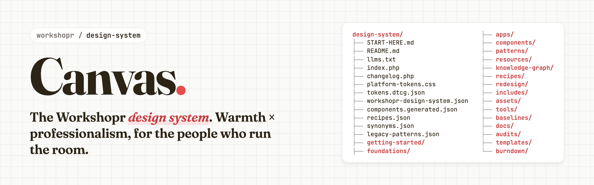

## Why it's called Canvas

Ten minutes before a session, someone tapes a sheet of butcher paper to the wall and rules a grid on it. By lunch the room has filled it in. Nobody argued about where the boxes went, because the structure was up before the first sticky note, so every bit of the room's energy went into the work.

That's the job this system does for Workshopr. The Planner, the Facilitator, Synthesize, Tips, the Academy and the rest are all painted onto the same ground: warm off-white paper instead of pure white, ink instead of black, one red, Fraunces for headlines and Inter for everything else, and a grid and spacing scale that don't move. Each app paints its own picture. None of them has to prime its own canvas.

The name also says who it's for. Facilitators work on canvases all day: the business model canvas, the team canvas, the wall of stickies. This is the one the product is built on. It's warm enough for people who run rooms for a living, and precise enough to hold up in a live session with forty people watching.

## What it is

Canvas is the design system behind workshopr.io: the tokens every app imports, the `ws_*` PHP components and their JavaScript twins in `js/ws.js`, a demo page and a playground preview for each, and the written rules for brand, voice, layout and motion. Browse it at [canvas.workshopr.io](https://canvas.workshopr.io/), or under `/design-system/` on workshopr.io.

## Where to start

- **Reading it:** [`START-HERE.md`](START-HERE.md) has the source-of-truth hierarchy, the workflow for building UI and the rules. The site's [Getting Started](getting-started/start-here.php) section covers the philosophy and voice.
- **Building with it** (from the platform repo): find a component with `npm run ds:find -- "what you need"`, read its entry in [`components.generated.json`](components.generated.json), and take every colour, space, radius and shadow from [`platform-tokens.css`](platform-tokens.css).
- **AI agents:** start at [`llms.txt`](llms.txt). The catalog is the contract, and [`knowledge-graph/knowledge-graph.json`](knowledge-graph/knowledge-graph.json) says how components, tokens, recipes and rules connect. Before changing a token or a helper, `npm run ds:graph -- <name> --impact` lists everything the change reaches.
- **Keeping it honest:** the checkers and generators live in [`tools/`](tools/), and the ratchets they hold the pages and catalog to live in [`baselines/`](baselines/).

## Where it lives

Canvas lives in the Workshopr platform repo under `design-system/`, and that copy is the source of truth. [github.com/bbulman/canvas-design-system](https://github.com/bbulman/canvas-design-system) holds a copy of the folder. The PHP pages include files from the platform (`includes/components/` and the analytics include), so they run there, not from this folder on its own.

## What's in each folder

The folders mirror the site's navigation. The URLs the pages had before they moved into folders (November 2026) redirect to them, through `.htaccess` in this folder. This map lists no counts and no file-by-file inventory: `ls` answers those and never goes stale.

```
design-system/
  START-HERE.md  README.md  llms.txt   entry points: the guide, this page, the short index for agents
  index.php  changelog.php             the microsite's home page and its changelog
  platform-tokens.css                  every token value; every app imports it
  workshopr-design-system.json         hand-maintained rules, phases, apps and curated option lists
  components.generated.json            the agent contract, generated (tools/generate-catalog.php)
  tokens.dtcg.json                     the tokens in W3C DTCG format, generated (tools/generate-tokens-dtcg.php)
  synonyms.json  legacy-patterns.json  recipes.json   inputs to the catalog and to ds:find

  getting-started/   start here, philosophy, voice, design decisions, overview, case study
  foundations/       colors, typography, icons, spacing, elevation, animations, illustrations
  apps/              one guide per app (app-*.php), app theming, the app shell layouts
  components/        the playground, the component library, In JavaScript, the review page
    demos/           one demo page per component
    php/  react/     component source for the React-based apps
  patterns/          patterns, composition (the screen recipes rendered), utilities, page templates, when to use
  resources/         presentations, video, accessibility, the token reference
  knowledge-graph/   knowledge-graph.json: how components, tokens, recipes and rules connect,
                     generated beside the catalog; query it with npm run ds:graph
  recipes/           each screen recipe as a runnable file (listed in recipes.json)
  redesign/          the app-shell redesign track
  includes/          the microsite's header and footer, the playground fixtures, the review page's data
  assets/            the playground, review and recipe stylesheets, the playground script, the slide grid,
                     the GitHub banner
  tools/             command-line checkers and generators (check-drift, check-page, generate-catalog,
                     generate-tokens-dtcg) and the Figma plugin script; refused over the web
  baselines/         the ratchets the checks hold pages and the catalog to; only Bill rebaselines
  docs/              written guides: adoption, native apps, theming, motion, the style guide,
                     illustration guidelines, colour system, debt registers, specs
  audits/            dated audits and the July 2026 token audit
  templates/         documentation templates
  burndown/          the design-system burn-down loop's runbook, locks and run logs
```
